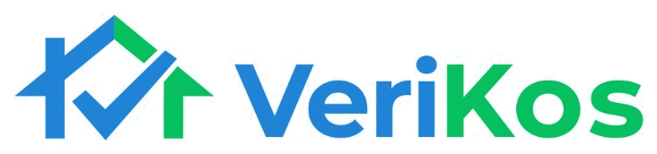

# VeriKos (Universitas Pendidikan Indonesia - Bandung)

<div align="center">
  
  <p><strong>Cari Kos Nyaman di Sekitar UPI, 100% Terverifikasi Amanah Bebas Penipuan.</strong></p>
</div>

---

## 🌟 Tentang VeriKos
**VeriKos** adalah platform agregator kos terverifikasi modern yang berfokus di kawasan kampus Universitas Pendidikan Indonesia (UPI) Bandung (mencakup area *Gegerkalong Girang & Hilir*, *Isola*, *Setiabudi*, *Sukasari*, dan *Ledeng*).

Platform ini memecahkan dua masalah utama dalam pencarian kos mahasiswa:
1. **Bebas Penipuan (Zero Scam Guarantee):** Setiap hunian bercentang biru diaudit fisik langsung oleh surveyor lapangan di lokasi (memverifikasi titik GPS, KTP pemilik, kecocokan buku rekening bank, dan sanitasi kamar).
2. **0% Potongan Komisi Sewa:** Pemilik kos tidak dipotong komisi 5%–15% seperti di OTA konvensional, melainkan menggunakan sistem langganan flat bulanan yang ramah kantong (*Mulai Rp75.000/bln*). Uang sewa mahasiswa 100% utuh masuk ke pemilik kos.
3. **Direct Chat WhatsApp:** Mahasiswa dapat langsung menghubungi pemilik resmi yang telah divalidasi identitasnya tanpa perantara calo.

---

## 🚀 Fitur Unggulan

- **Navbar Modern & Kampus Selector:** Dropdown pemilih radius area kampus UPI dengan indikator status audit.
- **Hero & Pencarian Real-Time:** Filter kategori (*Semua, Khusus Putri, Khusus Putra, Campur*), kisaran budget, sub-area UPI, dan toggle centang biru amanah.
- **Kartu Kos Interaktif:** Dilengkapi lencana tanggal audit surveyor, jarak & estimasi jalan kaki ke fakultas UPI (FPMIPA, FIP, FPSD, FPOK), chip fasilitas, dan direct WhatsApp button.
- **Modal Detail Lengkap:** Galeri foto kamar, **Laporan Hasil Audit Tim VeriKos (Checklist Validitas)**, spesifikasi teknis, aturan jam malam, dan kontak pemilik terverifikasi.
- **Cek Status Verifikasi Sertifikat:** Mahasiswa dan orang tua dapat memvalidasi kode sertifikat digital kos (misal: `VK-UPI-2026-0042`) untuk mencegah transfer ke akun penipu.
- **Paket Mitra Kos & Kalkulator Penghematan:** Menghitung langsung penghematan jutaan rupiah per tahun bagi pemilik kos dibanding dipotong komisi 10% di platform lain.
- **Panduan Edukasi Anti-Penipuan:** 3 aturan emas mahasiswa baru UPI agar aman dari sindikat kos fiktif di media sosial.
- **Fitur Favorit:** Menyimpan dan membandingkan kos yang disukai mahasiswa.

---

## 🛠️ Tech Stack

- **Framework:** React 19 + Vite 8
- **Styling:** Tailwind CSS + Vanilla Custom Tokens
- **Icons:** Lucide React
- **Typography:** Plus Jakarta Sans & Inter
- **Kontak Resmi WhatsApp:** `0822-8820-6271`

---

## 💻 Cara Menjalankan Secara Lokal

```bash
# Clone repository
git clone https://github.com/hmmdz09/verikos.git
cd verikos

# Install dependencies
npm install

# Jalankan server pengembangan
npm run dev
```

Buka [http://localhost:5173/](http://localhost:5173/) pada browser Anda.

---

## 📄 Lisensi & Hak Cipta
© 2026 **VeriKos Indonesia**. Dibuat untuk kenyamanan dan keamanan sivitas akademika UPI Bandung.
